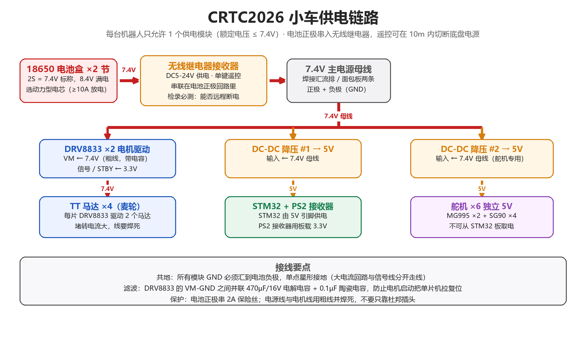
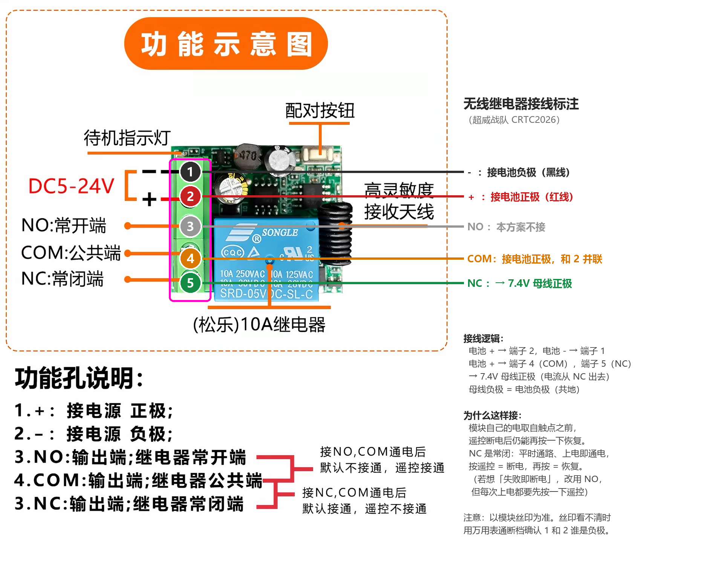
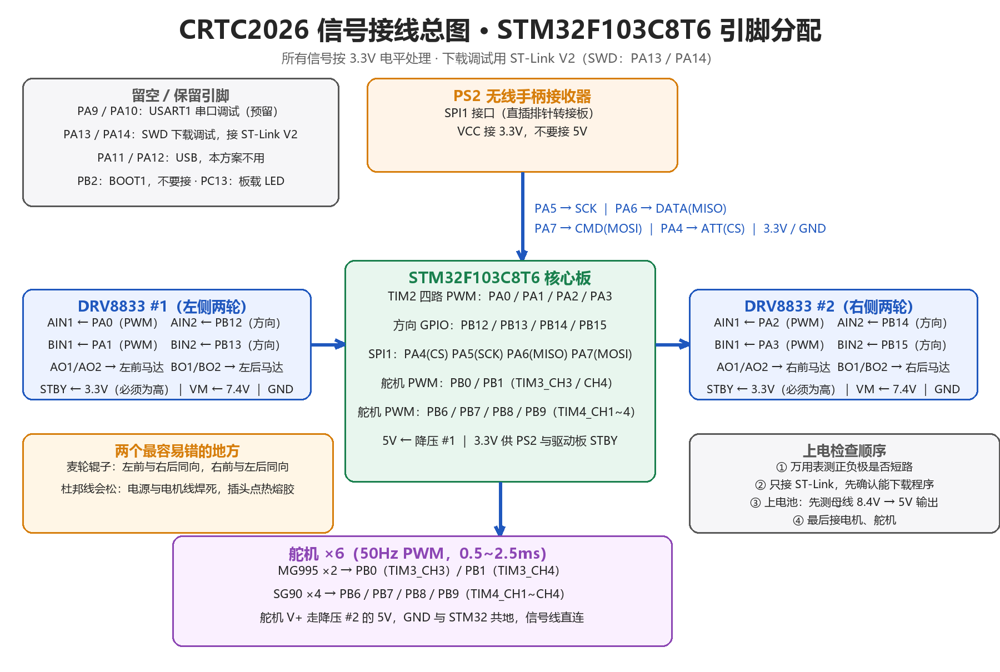
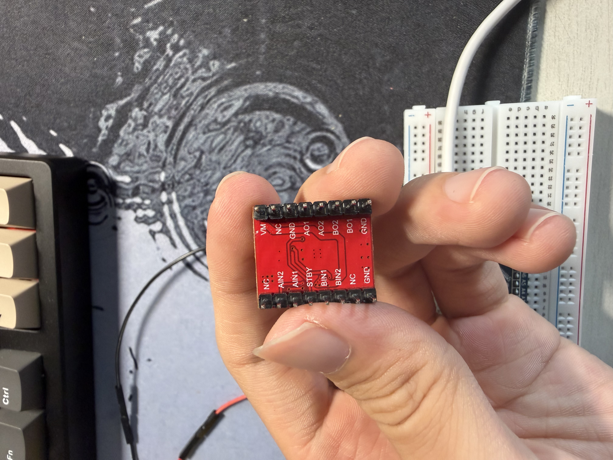
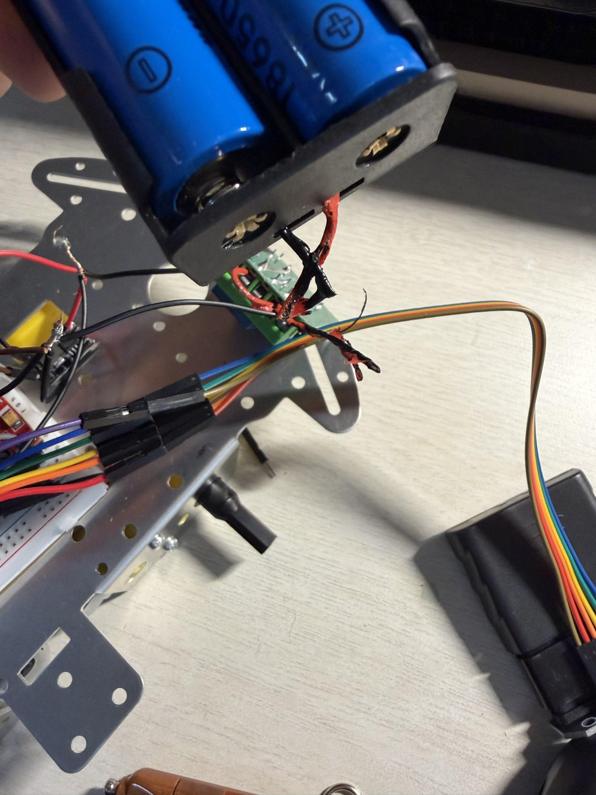

# 电气系统与接线

> 本文记录超威战队 CRTC2026 参赛机器人的供电链路与信号接线方案，按接线推进的先后顺序记录设计与调试过程。

## 供电链路设计（单供电模块，2S 7.4V）

### 功能描述

为整车（主控、电机驱动、6 路舵机、无线接收模块）提供稳定电源，并满足手册对电源的强制规范：

- 手册 3.2 通用技术规范：**指定使用 18650 电池；每台机器人仅允许安装 1 个供电模块，且供电模块额定电压不超过 7.4V。**
- 手册 3.3.5 电源管理规范：**必须适配官方指定的无线继电器，确保底盘电源能在 10m 范围内被单独遥控器切断；检录时会检测遥控断电功能。**
- 手册 3.2 注意事项：供电模块定义为**有且仅有一个输出接口**的供电装置；若继电器与电池组之间存在延长线或转接线，按离电池组最近的一端计算接口数量。

### 链路结构

```
18650×2（2S，7.4V 标称 / 8.4V 满电）
        │  粗线，串 2A 保险丝
        ▼
无线继电器接收器（接收器电源取自继电器触点之前）
        │
        ▼
7.4V 主电源母线
        ├─► DRV8833 ×2（VM）：驱动 4 个 TT 马达
        ├─► DC-DC 降压 #1 → 5V：STM32 5V 引脚、PS2 接收器（3.3V 由板上 LDO 提供）
        └─► DC-DC 降压 #2 → 5V：6 路舵机（独立供电）
```



### 选型与设计说明（为什么这样做）

1. **为什么用 2S 而不是更高电压**：手册限制供电模块额定电压 ≤7.4V，2 节 18650 串联正好是 7.4V 标称；DRV8833 的 VM 范围为 2.7~10.8V，8.4V 满电仍在安全区间。TT 马达标称 3~6V，7.4V 直驱转速更高但发热与磨损加快，因此程序中 PWM 限幅在 80% 左右。
2. **为什么舵机单独一路 5V**：MG995 堵转电流可达 2A 级别，6 个舵机同时动作的瞬时电流远超逻辑侧需求。若与主控共用一路 mini 降压模块，舵机启动会把 5V 拉低导致单片机复位。因此两片降压模块分工：逻辑一路、舵机一路，仅共地。
3. **为什么在电池正极串保险丝**：18650 短路电流可达数十安培，2A 保险丝可避免接线错误时烧毁模块或电池。
4. **为什么在 VM-GND 并联电容**：电机启动与堵转造成母线电压跌落，470µF/16V 电解电容 + 0.1µF 陶瓷电容可吸收低频与高频波动，避免主控被拉复位。

### 接线要点

- **继电器接法的关键**：接收器自身供电接在继电器触点之前（直接接电池正极），负载接在触点之后。若接反，遥控断电会同时切断接收器电源，此后无法再遥控上电，只能拔电池。
- **共地**：所有模块 GND 汇到电池负极，采用单点星形接地，大电流回路与信号线分开走线。
- 电池优先选用动力型电芯（放电能力 ≥10A），普通低倍率电芯带 4 电机堵转时压降明显。

### 实物接口识别（无线继电器 / 降压模块 / 主控）

#### 无线继电器接收器（5 个绿色端子）

端子从上到下依次是：**① −（电源负极）、② +（电源正极）、③ NO（常开）、④ COM（公共端）、⑤ NC（常闭）**。



本方案接法（用 NC，即“平时通路、按遥控断电”）：

| 端子 | 接到 |
| --- | --- |
| ① − | 电池负极 |
| ② + | 电池正极 |
| ④ COM | 电池正极（与 ② 并联） |
| ⑤ NC | 7.4V 母线正极（电流从 NC 流出） |
| ③ NO | 本方案不接 |

选择 NC 的理由：模块自身的电取自触点之前，遥控断电后仍能再按一下恢复；NC 为常闭，上电即通电，遥控按一下 = 断电、再按 = 恢复，且线圈平时不耗电。若希望“失败即断电”，可改用 NO，代价是每局开始都要先按一次遥控通电。

#### DC-DC 降压模块（MINI 5-30V 输入 / 3A）

- 背面丝印为 **IN+ / IN− / OUT+ / OUT−**，板上箭头由 IN 指向 OUT；输入端接 7.4V 母线，输出端为 5V。丝印看不清时用万用表通断档确认 IN− 与 OUT− 是否相通（共地）。
- 参数：输入 5~30V（须高于输出电压）、输出 5V、输出电流 3A（上限）、正常 1.6~1.8A、效率 96%、无使能脚。
- 校验方法：先只接输入、输出空载，用万用表直流电压档量输出焊盘是否为 5V；若为可调版本且不是 5V，用小螺丝刀调节板上电位器。
- **电流余量**：逻辑侧（主控 + PS2 接收器 + 驱动板逻辑）约 0.1A，余量充足；6 个舵机同时堵转可达数安培，远超本模块能力。因此不要让 6 个舵机同时发力，重载机构（MG995）建议单独配一路 5V 3A 以上的降压模块（增购件，记入成本表）。

#### STM32F103C8T6 核心板（蓝板）

- 两侧排针都有 `5V`、`GND`、`3.3V`；短边有一排 4 针 SWD 调试口（`3.3V / SWDIO / SWCLK / GND`），接 ST-Link V2。
- 供电：`5V` 引脚 ← 降压 #1 的 `OUT+`，`GND` ← `OUT−`；`3.3V` 由板上 LDO 输出，供 PS2 接收器与驱动板 STBY。
- `BOOT0` / `BOOT1` 跳线保持默认（都跳到 0），比赛过程中不要改动。

<!-- TODO 待补充：实际焊接照片、母线实测电压、舵机堵转时的电压跌落测量数据 -->

## 电机驱动接线（DRV 系列 ×2）

### 功能描述

用两片 DRV 系列驱动模块驱动四轮麦轮底盘，每片负责一侧（#1 左侧两轮、#2 右侧两轮），使左右两侧在程序中可对称控制。每片模块内含两个 H 桥，对应“一个 PWM 调速引脚 + 一个方向引脚”的控制方式。



### 实物引脚（红板丝印实测）

本队使用的驱动模块为红色小板，两排各 8 针，NC 为空脚：

| 排 | 引脚（按板上丝印顺序） |
| --- | --- |
| 功率 / 输出排 | VM · NC · GND · AO1 · AO2 · BO2 · BO1 · GND |
| 控制 / 信号排 | NC · AIN2 · AIN1 · STBY · BIN1 · BIN2 · NC · GND |



三个容易踩的点：

1. **STBY 必须接高电平（3.3V）**。STBY 即芯片的 nSLEEP 使能脚，悬空或接地时模块处于睡眠状态，电机完全不转——这是这块板最常见的“接完线电机不动”的原因。也可以把它接到一个 GPIO 上，用作软件急停。
2. **本板没有单独的逻辑电源 VCC 引脚**，逻辑供电由板上电路从 VM 取得，因此只需给 VM 供 7.4V、GND 与主控共地。
3. **B 通道的两个输出在排针上是反序的**（顺序为 AO1 · AO2 · BO2 · BO1），接线时按丝印逐个对应，不要按位置对称去猜。

### 驱动模块与主控的对应关系

| 驱动模块 | 模块引脚 | STM32 引脚 | 说明 |
| --- | --- | --- | --- |
| #1（左侧两轮） | AIN1 | PA0 | TIM2_CH1，A 通道调速 |
| #1 | AIN2 | PB12 | A 通道方向 |
| #1 | BIN1 | PA1 | TIM2_CH2，B 通道调速 |
| #1 | BIN2 | PB13 | B 通道方向 |
| #2（右侧两轮） | AIN1 | PA2 | TIM2_CH3，A 通道调速 |
| #2 | AIN2 | PB14 | A 通道方向 |
| #2 | BIN1 | PA3 | TIM2_CH4，B 通道调速 |
| #2 | BIN2 | PB15 | B 通道方向 |
| 两片 | STBY | 3.3V | 使能脚，必须为高电平 |
| 两片 | VM | 7.4V 母线 | 电机功率电源 |
| 两片 | GND | 电池负极 | 与主控共地 |
| #1 | AO1/AO2 → 左前马达，BO1/BO2 → 左后马达 | — | 输出极性可先任意接 |
| #2 | AO1/AO2 → 右前马达，BO1/BO2 → 右后马达 | — | 输出极性可先任意接 |

### 控制逻辑（DRV8833 真值表）

| IN1（调速脚） | IN2（方向脚） | 输出效果 |
| --- | --- | --- |
| PWM，占空比 d | 0 | 正转，转速 ∝ d |
| 0 | 1（常高） | 反转，转速 ∝ 1−d |
| 0 | PWM | 反转，转速 ∝ d（需要该引脚也具备 PWM 功能） |
| 1 | 1 | 刹车（短接制动，急停用） |
| 0 | 0 | 滑行（自由停止） |

本方案每路只用“一个 PWM 引脚 + 一个普通 GPIO”：前进时方向脚置 0，占空比 d 即转速；后退时方向脚置 1、把占空比写成 1−d，即可在不额外占用 PWM 通道的前提下实现后退调速；把两脚同时置 1 即为急停刹车。

### 设计说明

1. **为什么四路 PWM 全放在 TIM2**：同一路定时器、同一频率，电机 PWM 可统一设为 10~20kHz（超出人耳听觉范围，避免电机啸叫），且不占用舵机所需的 TIM3 / TIM4。
2. **为什么用“PWM + 方向”而不是两个 PWM**：占用引脚少、程序简单；四路电机若每路都用两个 PWM，需要 8 个 PWM 通道，本方案只需要 4 个（见上表占空比取反的说明）。
3. **为什么 STBY 不直接接 3.3V 而已**：也可以接到空闲 GPIO，便于调试阶段软件急停；但检录与比赛前必须保证使能有效。

### 调试记录

- 电机极性不必事先判断，先任意连接；上电试转后哪个轮子转向相反，就对调该电机的两根输出线。

### 定时器与引脚配置（STM32CubeMX 口径）

| 功能 | 引脚 | 外设配置 | 关键参数 |
| --- | --- | --- | --- |
| 四路电机 PWM | PA0 / PA1 / PA2 / PA3 | TIM2 CH1~CH4，PWM Generation | PSC=71、ARR=49 → 20kHz |
| 四路电机方向 | PB12 / PB13 / PB14 / PB15 | GPIO_Output（推挽、初始低） | 低电平=正转，高电平=反转 |
| PS2 手柄 SPI | PA5 / PA6 / PA7 | SPI1，Full-Duplex Master | CPOL=Low、CPHA=1Edge，时钟 ≤1MHz |
| PS2 片选 | PA4 | GPIO_Output | 软件拉低选中 |
| 舵机 6 路 PWM | PB0 / PB1 / PB6~PB9 | TIM3_CH3/CH4、TIM4_CH1~CH4 | PSC=71、ARR=19999 → 50Hz |
| 下载调试 | PA13 / PA14 | SYS → Debug = Serial Wire | 释放后仍保留下载口 |
| 系统时钟 | — | RCC：HSE 晶振 + PLL | SYSCLK = 72MHz |

### 电机接线与调试步骤

原则：**一次只增加一个变量**，出问题才找得到原因。

1. 先只接一片驱动板、只接一个电机：`AIN1`←PA0、`AIN2`←PB12、`STBY`←3.3V、`VM`←7.4V 母线、`GND`←母线负极，`AO1`/`AO2` 接电机的两根线（极性任意）。
2. 上电前用万用表确认驱动板 `VM` 对 `GND` 有 7.4V 左右。
3. 烧入测试程序：PA0 输出 60% 占空比、PB12 置低，电机应正转；把 PB12 置高并把占空比改成 `1−d`，应反转；两根同时置高为刹车。
4. 一个电机双向可控后，再依次接上其余三个通道，最后接第二片驱动板。
5. 四个电机都能独立转动后，再用 PS2 手柄把四路映射成底盘运动（前进 / 后退 / 横移 / 自转）。

<!-- TODO 待补充：四轮转向测试结果、前进 / 横移 / 自转的方向对应表 -->

## PS2 无线手柄接收器接线（SPI1）

### 功能描述

使用官方物资表中的 PS2 无线手柄（锁定款 + 直插排针转接板）作为唯一遥控方案，满足手册 3.2 无线电规范：**通讯方式仅可选其中一种，且发射源与接收源有且仅有一组。**

### 接线表

本队使用的接收板为 **XTARK TK-PS2A V1.0**，一排 6 个焊盘，丝印顺序为 `CLK / CS / CMD / DAT / VCC / GND`：

| 接收板丝印 | STM32 引脚 | 说明 |
| --- | --- | --- |
| CLK | PA5 | SPI1_SCK，主控输出时钟 |
| CS | PA4 | 片选（即手册中常写的 ATT / SEL），软件拉低选中 |
| CMD | PA7 | SPI1_MOSI，主控 → 接收板（命令） |
| DAT | PA6 | SPI1_MISO，接收板 → 主控（数据） |
| VCC | 3.3V | 注意：接 3.3V，不要接 5V |
| GND | GND | 与主控共地 |

**注意**：丝印顺序（CLK、CS、CMD、DAT）与常见 PS2 接收器的引脚顺序（DATA、CMD、ATT、CLK）并不一致，接线时按丝印逐个对应，不要按位置对称去猜。

### 设计说明

1. **为什么 VCC 取 3.3V**：主控 I/O 电平为 3.3V，接收器同样按 3.3V 供电可避免电平不匹配损伤引脚。
2. **DATA / CMD 是交叉关系**：接收器的数据输出接主控输入（MISO），命令输入接主控输出（MOSI），这是最容易接错的两根线。若接线正确仍读不到数据，先用示波器 / 逻辑分析仪确认 CLK 是否有时钟输出。

## ST-Link 下载与调试接线

### 功能描述

使用 ST-Link V2（Telesky 金壳款，2×5 排针）给 STM32F103C8T6 核心板下载与调试程序，接口取核心板短边的 SWD 四针（`3.3V / SWDIO / SWCLK / GND`）。

### 接线表

| ST-Link 外壳丝印 | 核心板 SWD 口 | 说明 |
| --- | --- | --- |
| SWCLK | SWCLK（CLK） | 时钟，必须接 |
| SWDIO | SWDIO（DIO） | 数据，必须接 |
| GND | GND | 共地，必须接 |
| 3.3V | 3.3V | 仅在核心板没有其他供电时接（由 ST-Link 给板子供电） |
| 5.0V | 不接 | 不要接 |
| RST | 可选（接核心板 RST） | 复位，通常不接也能正常下载 |
| SWIM | 不接 | STM8 专用 |

### 注意事项

1. **不要让 ST-Link 的 3.3V 和外部 5V 同时给核心板供电**。用电池给核心板供电（5V 引脚）时，ST-Link 只接 `SWCLK` / `SWDIO` / `GND` 三根；只用 ST-Link 调试时，核心板可以先不接电池。
2. 下载前确认核心板 `BOOT0`、`BOOT1` 跳线都在 0 位。
3. 电脑识别不到 ST-Link 时，先怀疑 USB 线——有些线只能充电、不能传数据。

## 舵机接线与供电

### 功能描述

6 路舵机（MG995 ×2 用于大负载机构，SG90 ×4 用于轻载荷机构）由 STM32 输出 50Hz PWM 控制，舵机电源取自独立的降压模块 #2。

### 引脚分配

| 舵机 | STM32 引脚 | 定时器通道 |
| --- | --- | --- |
| MG995 #1 | PB0 | TIM3_CH3 |
| MG995 #2 | PB1 | TIM3_CH4 |
| SG90 #1~#4 | PB6 / PB7 / PB8 / PB9 | TIM4_CH1~CH4 |

### 设计说明

1. **为什么舵机 PWM 放在 TIM3 / TIM4**：舵机必须使用 50Hz 固定频率，与电机 PWM（10~20kHz）分开使用不同定时器，互不干扰。
2. **为什么舵机电源不与主控共用**：见上文供电链路设计说明第 2 条。
3. **三线制接法**：舵机棕 / 黑线接 GND、红线接 5V、橙 / 黄线接信号。舵机信号线与电源线应分开走线，避免 PWM 信号被大电流干扰。

<!-- TODO 待补充：舵机中位角度标定结果、堵转 / 卡死保护策略 -->

## 上电与自检流程

### 功能描述

规定每次通电的检查顺序，避免因接线错误一次性烧毁多个模块。

### 流程

1. 万用表测电池盒输出：串联应为 7.4~8.4V（若只有约 3.7V，说明电池盒是并联接法，必须改接）。
2. 焊接电池 → 继电器 → 母线 → 两片降压模块，**先不接任何负载**。
3. 上电池，测量两路降压输出均为 5V，测母线电压，随后断开电池。
4. 接 ST-Link，仅用 USB 供电，确认能识别芯片并下载程序。
5. 接驱动模块 8 根信号线 → 接电机 → 接 PS2 接收器 → 最后接舵机。
6. 上电顺序测试：先测电机单转，再测四轮，再测手柄，最后测舵机。
7. 杜邦插头点热熔胶、扎带固定线束；电源线与电机线焊死，不依赖插头。

### 检录相关

- 结构强度检测：机器人从 150~200mm 高度以底面朝下自由下落，无零件掉出。因此线束与电池必须牢固固定。

### 自检记录

| 日期 | 检查项 | 预期 | 实测 | 结论 |
| --- | --- | --- | --- | --- |
| 10-12 | 电池盒输出（两节 18650） | 2S 串联，7.4~8.4V | 已用万用表确认为串联 | 通过 |
| 10-12 | 母线电压（继电器之后） | 与电池电压一致 | 7.23V | 通过 |
| 10-12 | 降压模块 #1 输出（逻辑供电） | 5.0V ± 0.1 | 4.77V（偏低，待调） | 待优化 |
| 10-12 | 降压模块 #2 输出（舵机供电） | 5.0V ± 0.1 | 4.89V（偏低，待调） | 待优化 |
| 10-12 | 遥控断电功能 | 按下断电、再按恢复 | 按住断电、松手立即恢复（模块出厂为点动模式） | 部分通过，待改自锁 |
| 10-13 | ST-Link 下载 | 能识别芯片并烧录程序 | 已成功烧录过程序 | 通过 |
| 10-14 | CubeMX 工程配置核对 | 引脚 / SPI1 / TIM2 / 时钟与设计一致 | 逐项核对无误（SPI1 = 281.25kHz、LSB First、CPOL High、CPHA 2Edge；TIM2 PSC=71/ARR=49；SYSCLK 72MHz；PA4 初始高） | 通过 |
| 10-14 | 固件工程编译 | 编译链接通过 | 通过（FLASH 9352B / 14.27%，RAM 1768B / 8.63%） | 通过 |
| 10-14 | 固件烧录并运行 | 程序能正常执行 | 通过（PC13 快闪 = 未接手柄时的正常提示；此前卡死在 SPI 等待的问题已修复） | 通过 |
| 10-14 | PS2 手柄通信（LED 常亮） | 能读到手柄数据 | 待测 | 待测 |
| 10-14 | PS2 遥控底盘四向运动 | 前进 / 后退 / 左转 / 右转正确 | 待测 | 待测 |
| — | 驱动板 STBY 使能 | STBY = 3.3V，电机可转 | 待测 | 待测 |
| — | 四轮转向一致性 | 前进指令下四轮同向 | 待测 | 待测 |

## 踩坑记录与迭代

### 遥控接收模块出厂默认为“点动”模式（10-12）

- **现象**：按住遥控器时母线电压掉到 0V，松手立即恢复；无法实现“按一下断电、再按一下恢复”。
- **原因**：市售单键无线继电器接收模块常见三种工作模式——点动（按住才动作）、自锁（按一下切换状态）、互锁（多路互斥）。本队收到的模块出厂为点动模式，与手册“断电遥控器”的习惯用法不一致。
- **处理方向**：按模块说明把模式切到自锁（通常通过板上的模式跳线帽，或长按学习/配对键后按遥控键，由指示灯闪烁次数选择模式）；若该批模块不支持切换，则保留点动模式，检录时主动向工作人员说明“按住即断电”，功能判定上仍可切断电源。
- **影响评估**：供电链路的接线本身已正确（按住可断电即证明 COM/NC 触点、接收器与遥控链路工作正常）。点动模式在比赛中的唯一风险是遥控器被误按时机器人会短暂断电后自动恢复，而自锁模式下误按会造成永久断电，两者各有取舍，需在检录前与组委会确认接受哪种。

### 待记录

- 继电器接反导致无法遥控上电的问题（待复现记录）
- 舵机动作引起主控复位的现象与电容 / 独立供电的改善效果（待测量）

### 降压模块损坏与临时单路供电（10-13）

- **现象**：调试过程中其中一块 Mini DC-DC 降压模块损坏，无法输出 5V。
- **临时方案**：暂时只用一块完好的模块给逻辑侧供电——逻辑侧负载（主控 + PS2 接收板 + 驱动板逻辑）仅约 0.1A，而模块正常输出能力 1.6~1.8A，余量充足，因此这一阶段不影响调试。
- **如果连一块都没有**：调试阶段可用核心板的 USB 口供电，但必须满足两个条件——(1) 与电池母线共地；(2) 不能同时插 USB 和外部 5V，因为蓝板的 USB 5V 与 5V 引脚相通，两路会互相灌电流，可能损坏 USB 口。
- **影响与后续**：舵机要等第二路 5V 到位才能接入。补购时建议一次备 2~3 块，并考虑增购一块 5V 3A 以上的模块专门供舵机。
- **规则提醒**：检录要求整车只有一块额定电压 ≤7.4V 的供电模块，使用充电宝替代供电不算合规。

### 电源回路短路烧毁线路、无线继电器损坏（10-14）

- **现象**：接上电池后，电池盒输出至继电器之间的接线（未焊接的拧接接头处）绝缘层炭化，无线继电器模块随之损坏，无法继续使用。



- **当时状态**：电池、无线继电器、降压模块、两片驱动板以及面包板上的全部跳线均已连接，属于“全部负载同时上电”；上电后约 3~4 秒即烧断。
- **薄弱点分析**：该段为电池盒原装细线（约 26AWG）＋未焊接的拧接接头，是整条电源回路中电阻最大、耐流最小的地方。一旦出现大电流（外部短路或模块内部击穿），最先发热烧毁的就是这里，因此“烧点”本身不能直接说明故障出在哪。
- **可能原因（待用万用表逐项确认）**：
  1. 继电器模块输入正负极接反 → 模块内部击穿，输入端近似短路，相当于电源被直接短路；
  2. 电源回路存在外部短路：接线互相搭接，或电源线蹭到金属底盘形成回路（底盘是导体，本次接线确实搭在金属底盘上）；
  3. 继电器触点侧（COM / NC）接线错误，使电源经触点直接短路。
  4. **接线工艺问题（照片证据，最可疑）**：照片中可见多处接头未焊接、铜丝裸露，其中一处裸铜绞接端就翘在金属底盘上方几厘米处，另一处裸铜丝直接搭在其它跳线上。金属底盘是导体，只要两个本不该相连的裸点同时接触底盘（或某一裸点接触到已与负极相通的部位），就会形成完全短路。
- **现象与原因吻合**：短路时 18650 2S 电池可输出数十安培，而电池盒原装线仅约 26AWG 且接头未焊接，是整条回路中最薄弱环节，因此在 3~4 秒内迅速烧毁。
- **整改措施（补件到位前必须完成）**：
  1. 电池正极串 **2~3A 保险丝**，此条在本届比赛中强制执行；
  2. 电池到继电器的电源线换用 **≥20AWG 硅胶线**，接头焊接并套热缩管，禁止拧麻花；
  3. 所有电源线束远离金属底盘，必要时垫绝缘或改走塑料件；
  4. 每次上电前用万用表确认电池极性（红正黑负），并测量正负极之间不短路；
  5. 新继电器到货后先**空载验证**（只接电池与继电器，不接母线），确认遥控断电正常后再接入整车。
  6. **所有接头必须焊接并套热缩管**，不允许任何裸铜外露、更不允许裸铜悬空；线束与金属底盘之间必须做绝缘隔离（垫绝缘胶带或改用塑料走线）。
  7. **统一线色**：红 = 电源正、黑 = 电源负，其余颜色只走信号，便于后续排查（本次接线颜色混杂，是排查困难的原因之一）。
  8. 上电顺序固定为“先空载测电压、再接负载”，并遵循 2.6 节“电机接线与调试步骤”中一次只增加一个变量的原则。
- **影响与对策**：继电器需补购（物资表 ¥13.8/个，建议一次买 2~3 个备用）。补件到位前，采用“电池直接接母线、靠手动插拔断电”的方式继续调试固件与底盘运动，不阻塞开发进度。

## 物料清单与成本

> 新生组成本规范：整机造价不推荐超过 400.00 元；比赛结束后需自行制作报销单，总报销金额不超过 400.00 元。

| 序号 | 物品 | 规格 | 数量 | 单价 | 小计 |
| --- | --- | --- | --- | --- | --- |
| 1 | STM32 核心板 | STM32F103C8T6 | 2 | 待填 | 待填 |
| 2 | 电机驱动 | DRV 系列模块 | 4 | 待填 | 待填 |
| 3 | TT 马达 | 单轴 1:48 | 8 | 待填 | 待填 |
| 4 | 麦克纳姆轮 | 60mm 黄色，一套 4 个 | 2 套 | 待填 | 待填 |
| 5 | 小车底盘 | 四轮金属折弯板 | 2 | 待填 | 待填 |
| 6 | 舵机 | MG995 / SG90 | 4 / 8 | 待填 | 待填 |
| 7 | 无线继电器 | DC5-24V | 2 | 待填 | 待填 |
| 8 | 电池与充电器 | 18650 动力电芯 + 双槽充电器 | 4 + 1 | 待填 | 待填 |
| 9 | 降压模块 | Mini DC-DC 5V | 4 | 待填 | 待填 |
| 10 | 杂项 | 面包板、杜邦线、ST-Link 等 | — | 待填 | 待填 |

<!-- TODO 待补充：以购买发票为准填写实际单价与总价 -->

## 开源项目说明

<!-- TODO 待补充：若使用开源项目（如 PS2 手柄驱动库、麦轮运动学代码），在此完整说明项目名称、来源、协议与使用范围 -->

目前本阶段接线与电路方案均为自行设计，未使用开源项目。
